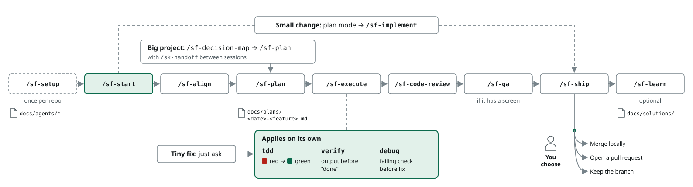

<p align="center">
  
</p>

<h1 align="center">software-factory</h1>

<p align="center">Agent skills that take software from an idea to a reviewed, verified, shipped change.</p>

<p align="center">
  <a href="https://github.com/rishabh0111/software-factory/actions/workflows/check.yml"></a>
  <a href="LICENSE"></a>
  <a href="https://rishabh0111.github.io/software-factory/"></a>
  
</p>

> **Quick start:** In Claude Code 2.1.295 or later, run `/plugin install sf-core --marketplace rishabh0111/software-factory`, then `/sf-setup` once in your repository, then `/sf-start`. The guide and the full command sheet are at [rishabh0111.github.io/software-factory](https://rishabh0111.github.io/software-factory/).

## Why

Left to itself, a coding agent tends to fail in ways you have probably seen:

- It says "done" when it has not run the tests.
- It patches a bug it never reproduced, and the bug comes back.
- Every interface it builds has the same generic look.
- It reviews its own code and finds nothing wrong.
- Two skill packs each assume they own the process, and their instructions collide.

software-factory is one set of skills that share the same files and the same rules. Some are disciplines that apply on their own whenever the work calls for them: tests come first, a bug gets a failing check before a fix, nothing is called done until command output shows it, and every screen meets a design floor. The others wait until you type them, and each runs one piece of work: aligning on an idea, planning, building, reviewing, testing in a browser, shipping. Reviews run in agents that did not write the code.

There is no fixed pipeline. A small fix is just an ask; a feature usually runs align, plan, execute, review, ship; any step also works on its own.

## Install

```
/plugin install sf-core --marketplace rishabh0111/software-factory
/sf-setup
/sf-start
```

`sf-core` brings the general-purpose skills from [rishabh0111/skills](https://github.com/rishabh0111/skills) with it. `/sf-setup` runs once per repository and records your issue tracker (GitHub, GitLab, Bitbucket or local files), your test and build commands, labels, where docs live, and which optional tools are installed. `/sf-start` asks what you are working on and names the command to run next. The skills need git; `sf-ship` uses `gh` or `glab` to match your host.

<details>
<summary>Add the optional plugins</summary>

Install them per project, only where you need them. Each one is listed under [Plugins](#plugins).

```
/plugin install <plugin> --marketplace rishabh0111/software-factory
```

</details>

<details>
<summary>Optional tools that <code>/sf-setup</code> looks for</summary>

`/sf-setup` detects these and writes what it found to `docs/agents/tools.md`. Every skill that uses one has a fallback.

| Tool | Without it |
|---|---|
| A headless browser CLI, for QA, benchmarks and screenshots | The chrome-devtools MCP server |
| Image generation, for design mockups | HTML mockups |
| A second-model CLI, for a second opinion on plans and decisions | A fresh subagent with no session context |
| A design-check CLI, for design audits | The design skill's own checks |

</details>

## Usage

Ask in plain words, or type a command:

```text
fix the off-by-one in the pagination helper      # sf-tdd and sf-verify apply on their own
the export button does nothing in Safari          # sf-debug reproduces it before any fix
/sf-align  add team invites to the admin area
/sf-plan
/sf-execute docs/plans/2026-10-24-team-invites.md
/sf-code-review
/sf-qa
/sf-ship  open a pull request
/sf-ask  which skill checks a risky migration?
```

| You have | Run |
|---|---|
| A small fix | Just ask. Tests and verification apply on their own |
| A bug | Describe the symptom; `sf-debug` builds a failing check first |
| A feature | `/sf-align` → `/sf-plan` → `/sf-execute` → `/sf-code-review` → `/sf-ship` |
| A user interface | The feature path, with `/sf-design` before building and `/sf-qa` before shipping |
| A big or unclear effort | `/sf-decision-map` → `/sf-plan`, with `/sk-handoff` between sessions |
| An unfamiliar codebase | `/sf-map-codebase` |

## How it works

<p align="center">
  
</p>

1. `/sf-setup` writes `docs/agents/`, which every other skill reads for your tracker, commands and tools.
2. `/sf-align` interviews you in rounds and records the project's terms and decisions; `/sf-plan` turns the result into a spec, tickets or a task-by-task plan under `docs/plans/`.
3. `/sf-execute` runs the plan task by task, or `/sf-implement` builds one ticket. Underneath, `sf-tdd` drives each slice red then green and `sf-verify` refuses "done" without fresh output.
4. `/sf-code-review` reviews the change for standards, the spec and quality, each in an agent that did not write it. `/sf-qa` tests a screen in a real browser.
5. `/sf-ship` opens or lands the pull request, deploys and watches production. `/sf-learn` saves a lesson to `docs/solutions/` when a future session would repeat the mistake.

## Commands

Commands in `sf-core`. The [command sheet](https://rishabh0111.github.io/software-factory/commands.html) has every plugin, and `/sf-ask` says which one fits.

<!-- commands:start -->
### You run (20)

| Command | What it does |
|---|---|
| `/sf-start` | Asks one question, names the next command. |
| `/sf-setup` | Records tracker, commands, labels, docs layout and tools. |
| `/sf-align` | Interviews you to sharpen a plan. |
| `/sf-plan` | Spec, tickets, or a per-task implementation plan. |
| `/sf-plan-review` | Reviews a plan for scope, engineering, design, DX. |
| `/sf-design` | Design system, art direction, variants, refine and critique. |
| `/sf-execute` | Runs a written plan task by task, then one fresh review. |
| `/sf-implement` | Builds one ticket or spec, no written plan. |
| `/sf-qa` | Tests the running app and fixes what it finds. |
| `/sf-benchmark` | Measures page speed before and after a change. |
| `/sf-devex-review` | Tries your docs and onboarding live, scores the DX. |
| `/sf-ship` | Opens or lands the PR, deploys, watches production. |
| `/sf-release-docs` | Brings the docs in line with what shipped. |
| `/sf-learn` | Retro on a session; capture or refresh lessons. |
| `/sf-decision-map` | Maps a big effort as decision tickets. |
| `/sf-map-codebase` | Maps an existing codebase into reference docs. |
| `/sf-triage` | Turns issues and PRs into agent-ready briefs. |
| `/sf-architecture-review` | Finds deeper modules, shows an HTML report. |
| `/sf-guard` | Asks before destructive commands; freezes edits to one folder. |
| `/sf-ask` | Which skill or flow fits your situation. |

### Applies on its own (15)

| Skill | What it does |
|---|---|
| `sf-tdd` | A failing test before any implementation code. |
| `sf-debug` | Reproduce with a failing test, then fix. |
| `sf-verify` | Nothing is done until fresh command output shows it. |
| `sf-code-review` | Standards, spec and quality, reviewed in parallel. |
| `sf-respond-to-review` | Verifies each review comment, then fixes or pushes back. |
| `sf-doubt-check` | Fresh-context challenge of a decision in flight. |
| `sf-source-check` | Grounds decisions in official documentation. |
| `sf-incremental-build` | Thin, verifiable slices. |
| `sf-simplify-code` | Clearer code, same behaviour. |
| `sf-frontend-ui` | Design quality floor for every screen you build. |
| `sf-module-design` | Vocabulary for deep modules and seams. |
| `sf-prototype` | Throwaway code to answer a design question. |
| `sf-glossary` | Keeps the project's domain terms sharp. |
| `sf-docs-and-adrs` | Records decisions and documentation. |
| `sf-worktrees` | An isolated workspace for the work. |
<!-- commands:end -->

## Plugins

`sf-core` is the whole path. The others are optional.

<!-- plugins:start -->
| Plugin | What it adds | What is inside |
|---|---|---|
| `sf-reviewers` | Specialist review agents: code, silent failures, tests, types, comments, simplification. | You run: `/sf-reviewers:review-pr`<br>Agents: `code-simplifier`, `comment-analyzer`, `guideline-reviewer`, `pr-test-analyzer`, `silent-failure-hunter`, `type-design-analyzer` |
| `sf-security` | Security audit and build-time hardening. | On its own: `sf-security-and-hardening`, `sf-security-audit` |
| `sf-security-deep` | Differential review of risky changes and variant analysis after a bug (CC-BY-SA-4.0). | You run: `/sf-security-deep:diff-review`<br>On its own: `sf-differential-review`, `sf-variant-analysis`<br>Agents: `adversarial-modeler` |
| `sf-ops` | CI/CD, migrations, observability, performance, constraints, incident response and deploy checklists. | On its own: `sf-ci-cd-and-automation`, `sf-constraint-driven-development`, `sf-deploy-checklist`, `sf-deprecation-and-migration`, `sf-incident-response`, `sf-observability-and-instrumentation`, `sf-performance-optimization` |
<!-- plugins:end -->

## Common questions

**Do I need every plugin?**
No. `sf-core` covers the path from idea to ship. Add an optional plugin from [Plugins](#plugins) only to the projects that need it.

**What runs on its own?**
The skills under [Applies on its own](#commands): they load when the work matches their description, such as a bug, a test, a claim that something is done, or a screen. Everything under "You run" waits until you type it.

**Does it work with other agents that read SKILL.md?**
The skills are plain `SKILL.md` folders under `plugins/<plugin>/skills/`, so another agent can load them. The install command, the dependency on `skills-core` and the hooks behind `sf-guard` are Claude Code features, and some skills dispatch subagents.

**Does it work on Windows?**
Yes. The scripts some skills run need Bash; on Windows, Git Bash provides it.

**How do updates from upstream work?**
Many skills began as open-source skills by other authors. [UPSTREAM.md](UPSTREAM.md) records the source repository, the commit copied and the paths for each one. `scripts/upstream-diff.sh <path-to-upstream-clone>` lists the upstream commits since then that touch those paths, and fixes are ported by hand.

## Related

- [agent-factory](https://github.com/rishabh0111/agent-factory): specialist agents for company work, one per department.
- [skills](https://github.com/rishabh0111/skills): general-purpose skills for thinking, writing and research. `sf-core` installs them.

## Contributing

To add a skill, create `plugins/<plugin>/skills/sf-<name>/SKILL.md`; `/sk-build-skill` helps you write and test it. Give it a short label in `docs/commands.labels.json`, then run:

```
node scripts/build-site.mjs
```

That regenerates the command sheet, the `sf-ask` catalog and the tables in this README. CI runs `node scripts/build-site.mjs --check` and `claude plugin validate . --strict`, and fails when either is out of date.

## License

[MIT](LICENSE) for this repository's own files. Bundled content keeps its own licence, which sits beside it: each plugin folder holds the licence files for its skills. [UPSTREAM.md](UPSTREAM.md) lists the source of every skill, agent and command.
