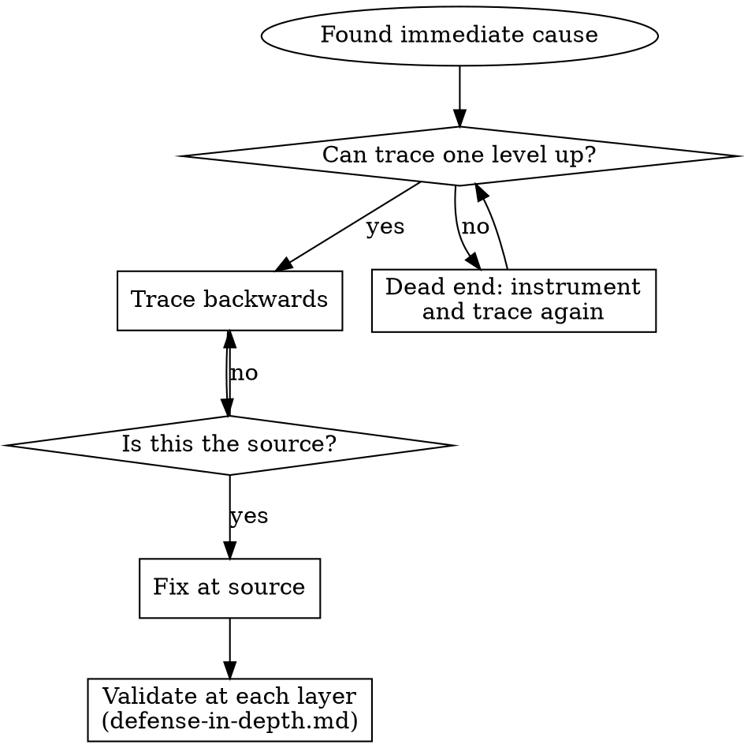

# Root-cause tracing

Reached from `sf-debug` Phase 4 when the error surfaces far from its cause: deep in a call stack, in one layer of a multi-component system, or in a test that passes alone but fails in the suite. The instinct is to fix where the error appears; that treats the symptom.

**Core principle:** trace back to where the bad value or state first enters, and fix it there.



## Trace backwards through the call stack

1. **Observe the symptom.**
   ```
   Error: git init failed in ~/project/packages/core
   ```
2. **Find the immediate cause**: the code that directly produces it.
   ```typescript
   await execFileAsync('git', ['init'], { cwd: projectDir });
   ```
3. **Ask what called it.**
   ```
   WorktreeManager.createSessionWorktree(projectDir, sessionId)
     → called by Session.initializeWorkspace()
     → called by Session.create()
     → called by a test at Project.create()
   ```
4. **Ask what value was passed.** `projectDir = ''`. An empty `cwd` resolves to `process.cwd()`, which is the source directory.
5. **Keep going up until you reach the origin.**
   ```typescript
   const context = setupCoreTest(); // returns { tempDir: '' } until beforeEach runs
   Project.create('name', context.tempDir); // read at the top level, before beforeEach
   ```

**Root cause:** a top-level variable read an empty value before setup ran. **Fix at the source:** make `tempDir` a getter that throws when read before `beforeEach`. Then validate at the layers it passed through, per [defense-in-depth.md](defense-in-depth.md).

## When you can't trace by hand: capture the stack

Log just before the dangerous operation, not after it fails, with the context that distinguishes callers:

```typescript
async function gitInit(directory: string) {
  console.error('[DEBUG-a4f2] git init', {
    directory,
    cwd: process.cwd(),
    nodeEnv: process.env.NODE_ENV,
    stack: new Error().stack,
  });
  await execFileAsync('git', ['init'], { cwd: directory });
}
```

```bash
npm test 2>&1 | grep 'DEBUG-a4f2'
```

- In tests, write with `console.error()`: a logger may be suppressed.
- Include the directory, cwd, environment variables and timestamps.
- `new Error().stack` shows the complete call chain.
- In the captured stacks, look for test file names, the line that triggers the call, and the pattern (same test? same parameter?).

## Trace across component boundaries

When the system has several components (CI → build → signing, API → service → database), instrument **every boundary in one run** before proposing anything. At each boundary, log what data enters, what data exits, whether environment and config propagated, and the state at that layer. Run once, read where the evidence breaks, then investigate that one component.

```bash
# Layer 1: workflow
echo "[DEBUG-b71c] workflow IDENTITY: $([ -n "${IDENTITY:-}" ] && echo SET || echo UNSET)"

# Layer 2: build script
printenv IDENTITY >/dev/null 2>&1 && echo "[DEBUG-b71c] build: IDENTITY set" || echo "[DEBUG-b71c] build: IDENTITY unset"

# Layer 3: signing script
security list-keychains
security find-identity -v

# Layer 4: the signing itself
codesign --sign "$IDENTITY" --verbose=4 "$APP"
```

This shows which hand-off fails (secrets → workflow ✓, workflow → build ✗). Print whether a secret is set, never its value.

## Find which test pollutes

Something appears during the suite (a stray `.git`, a file, leftover state) and you don't know which test creates it. Bisect with the bundled script, which runs the test files one by one and stops at the first that creates the path:

```bash
bash scripts/find-polluter.sh '.git' 'src/**/*.test.ts'
TEST_CMD='npx vitest run' bash scripts/find-polluter.sh '.git' 'src/**/*.test.ts'
```

`TEST_CMD` defaults to `npm test`; set it to the single-test-file command from the `## Testing` section of `CLAUDE.md` or `AGENTS.md`.
