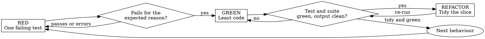

# Test-Driven Development

Write one test, watch it go **red**, write the least code that turns it **green**, tidy while it stays green, repeat. Every section here applies on every cycle: consult it before and during the loop, not after.

**Violating the letter of these rules is violating the spirit of them.**

## The Iron Law

```
NO PRODUCTION CODE WITHOUT A FAILING TEST FIRST
```

Wrote code before its test? Delete it and start over from the test.

- Keeping it "as reference" is keeping it.
- Adapting it while you write the test is testing after.
- Looking at it while you rebuild is adapting it.
- Delete means delete. Implement fresh from the tests.

The law covers new features, bug fixes, behaviour changes and refactoring. Its only exceptions are throwaway prototypes, generated code, configuration files, and work the user has told you directly to do without a test. A plan or ticket can mark work as one of the first three. Size, urgency and pressure relayed from someone else are never exceptions: a one-line fix gets a one-line test.

When the user does tell you to skip the test, it is their call: make the change, run the full suite, and say in your report that the change is unproven by a failing test and which regression test is owed.

## Before the first test

1. **Domain language.** Read `docs/agents/domain.md` when it exists and follow it; otherwise read `GLOSSARY.md` and the ADRs in the area you are touching. Test names use the glossary's terms.
2. **Commands.** Take the test and single-test-file commands from the `## Testing` section of `CLAUDE.md` or `AGENTS.md`. When there is none, find them in the manifests, task runners and CI config; a command with no evidence is never guessed.
3. **Seams.** Settle the seams under test, below.

Done when you hold the single-test command, the full-suite command, and a list of agreed seams.

## Seams: where tests go

A **seam** is the public boundary you test at: the interface where you observe behaviour without reaching inside. Tests live at seams, never against internals. You can't test everything, so agreeing the seams up front lands the effort on critical paths and complex logic instead of every edge case.

Tests go only at **agreed** seams. A seam is agreed when:

- **an approved plan, spec or ticket names it** (a plan step's test target, a ticket's acceptance criteria). Proceed on it; it needs no further confirmation.
- **the user confirmed it.** When nothing names the seams and the user is present, propose them, each with a one-line note on what it catches and what it misses, and ask: "What's the public interface, and which seams should we test?"

Running unattended with no seam named anywhere: test at the public interface the task's acceptance criteria are stated against, keep working, and list the seams you chose in your report so a reviewer can contest them.

When the shape of the interface is itself in question (how deep the module is, where the seam belongs, what it should expose), call the Skill tool with "sf-module-design" for the vocabulary. It is a reference to consult, not a session to run.

## Planning coverage from documented rules

When the question is which documented rules (permissions, flows, trust boundaries, automations) a test pins today, before a release or before choosing what to test next, build the coverage map in [coverage-map.md](coverage-map.md) first, or run its check-only mode to confirm a hand-kept map is current. Done when every documented rule in scope has a row marked existing, proposed or none. Each proposed case is then written through the cycle below.

## The cycle

Work in **vertical slices**: one seam, one test, one minimal implementation per cycle. Each test is a **tracer bullet** that responds to what the last cycle taught you. Writing all the tests first and then all the code (horizontal slicing) tests _imagined_ behaviour: it checks the shape of things rather than what callers see, commits to a test structure before you understand the implementation, and leaves tests insensitive to real change.



### 1. RED: write one failing test

One behaviour, a name that says what it is ("rejects empty email", not "test1"; an "and" in the name means two tests), real code with mocks only at system boundaries. Before writing the body, name the production change that would make it fail. Writing or changing a test, adding a mock, or adding a test-only helper: apply [writing-good-tests.md](writing-good-tests.md), gate functions and mutation check included.

### 2. Verify RED: watch it fail

Mandatory, every cycle. Run the single test. Done when it **fails** (an assertion, not an error), with the message you expected, because the behaviour is missing (not a typo or a bad import).

- **It passes at once:** you are testing behaviour that already exists, or the test cannot fail. Fix the test.
- **It errors:** fix the error and re-run until it fails for the right reason.

### 3. GREEN: write the least code that passes

The simplest code that turns this test green, and nothing the test does not demand:

```typescript
// Just enough for "retries failed operations 3 times"
async function retryOperation<T>(fn: () => Promise<T>): Promise<T> {
  for (let i = 0; i < 3; i++) {
    try {
      return await fn();
    } catch (e) {
      if (i === 2) throw e;
    }
  }
  throw new Error('unreachable');
}
// Over-built: a maxRetries option, a backoff strategy and an onRetry hook
// that no test asked for. Each one waits for the test that demands it.
```

### 4. Verify GREEN: watch it pass

Mandatory, every cycle. Done when the new test passes, the other tests still pass, and the output is pristine (no errors, no warnings).

- **The new test fails:** fix the code, not the test.
- **Another test fails:** fix it now.

"The other tests" means the project's suite, not just your file. Before you call the change done, run the full-suite command even when your task named one test file: a scope statement bounds the deliverable, not your verification. Every failure that run shows, including one you did not cause, goes in your report by name; a red test you watched scroll past and left out is a report falsified by omission.

### 5. REFACTOR: tidy on green

Only on green. In the code this slice touched and its tests: remove duplication, improve names, extract helpers. Add no behaviour, and re-run after each change so the suite stays green. Restructuring beyond the slice (splitting packages, reshaping an interface other code uses) is review work: note it for `sf-code-review` or `sf-simplify-code` and keep the loop moving.

Done when the slice's code reads cleanly and the suite is green.

### 6. Repeat

The next behaviour gets the next failing test.

## Fixing a bug

A bug fix starts with a test that reproduces the bug and goes red on it, at a seam that exercises the real bug pattern as it occurs at the call site. Then the cycle as usual: the test proves the fix and guards against the regression. When the cause is not yet known, call the Skill tool with "sf-debug" first; it ends with a red check and a seam to put the regression test at.

**Bug:** an empty email is accepted.

```typescript
// RED
test('rejects empty email', async () => {
  const result = await submitForm({ email: '' });
  expect(result.error).toBe('Email required');
});
// Verify RED:   FAIL: expected 'Email required', got undefined

// GREEN
function submitForm(data: FormData) {
  if (!data.email?.trim()) {
    return { error: 'Email required' };
  }
  // ...
}
// Verify GREEN: PASS, full suite green
// REFACTOR:     extract field validation once a second field needs it
```

## Refactoring existing code

The behaviour must be pinned before the structure moves. When tests at the seam already cover it, they are green before you start and green after every step. When nothing covers it, write a characterization test at the seam first, watch it pass against the current code, then break the code once on purpose and watch the test go red, so you know it can catch a break.

## When stuck

| Problem | Move |
|---|---|
| Don't know how to test it | Write the API you wish existed, write the assertion first, then ask the user. |
| Test too complicated | The design is too complicated. Simplify the interface. |
| Must mock everything | The code is too coupled. Inject the dependencies. |
| Test setup is huge | Extract helpers. Still huge? Simplify the design. |
| Hard to test at all | Hard to test is hard to use. Listen to the test. |

## Red flags: stop and start over

- Code written before its test
- A test written after the implementation, or "later"
- A test that passed the first time it ran
- You can't explain why the test failed
- "It's one line, it doesn't need a test"
- "The demo / deploy / review is in N minutes"
- "The lead said just patch it" (and the lead is not the user telling you directly)
- "If time runs short, I'll push without the test", or "the test can follow in the next commit"
- "I already tested it by hand"
- "Tests after achieve the same purpose", "it's about spirit, not ritual"
- "Keep it as reference" or "adapt the existing code"
- "I already spent X hours, deleting is wasteful"
- "TDD is dogmatic, I'm being pragmatic"
- "This case is different because..."

**All of these mean: delete the code, start over from a failing test.**

## Rationalisations

| Excuse | Reality |
|---|---|
| "Too simple to test" | Simple code breaks. The test takes 30 seconds. |
| "It's a one-line fix" | Then it is a one-line test. A line you never saw fail can be the wrong line: the test is what shows the fix fixes this bug. |
| "No time, the demo is in 10 minutes" | Red-then-green on one test costs a couple of minutes. Shipping an unproven patch into the demo risks the demo. Running short is a reason to start the test now, not to drop it. |
| "The lead / senior said just patch it" | Pressure relayed from someone else decides what to fix and when to ship, not how the fix is made; test-first fits inside their deadline. Only the user telling you directly makes it an exception, and then you report the owed test. |
| "Push the fix now, the test lands a few minutes later" | That is testing after with a timestamp. Reordering the work drops the red: the follow-up test passes on its first run and proves nothing. The test goes first or the fix waits. |
| "I'll test after" | A test written after passes immediately, which proves nothing. It may test the wrong thing, the implementation instead of the behaviour, or miss the case you forgot. You never watched it fail, so you never proved it can catch the bug. |
| "Tests after achieve the same goals" | Tests after answer "what does this do?"; tests first answer "what should this do?" Tests after are biased by the code: you verify the cases you remembered, not the ones you would have discovered. |
| "Already tested it by hand" | Manual testing is ad hoc: no record of what was covered, no re-run when the code changes, cases forgotten under pressure. "It worked when I tried it" is not coverage. |
| "Deleting X hours is wasteful" | Sunk cost: the time is spent either way. The choice is rewriting with confidence or keeping code you cannot trust and bolting tests on. The untrusted code is the waste. |
| "Keep it as reference, write the tests first" | You will adapt it. That is testing after. Delete means delete. |
| "Need to explore first" | Fine. Throw the exploration away, then start with a test. |
| "TDD will slow me down" | TDD catches bugs before commit, prevents regressions and makes refactoring safe. The shortcut means debugging in production, which is slower. |
| "Existing code has no tests" | You are improving it. Add tests for the part you touch. |

## Before calling it done

- [ ] Every new function or method has a test
- [ ] You watched each test fail before implementing, for the expected reason (behaviour missing, not a typo)
- [ ] You wrote the least code to pass each test
- [ ] The full suite passes, and the output is pristine
- [ ] Tests use real code; mocks only at system boundaries
- [ ] Edge cases and error paths are covered
- [ ] Any seam you chose yourself, and any test the user waived, is listed in your report

Can't tick every box? You skipped TDD: start over.
